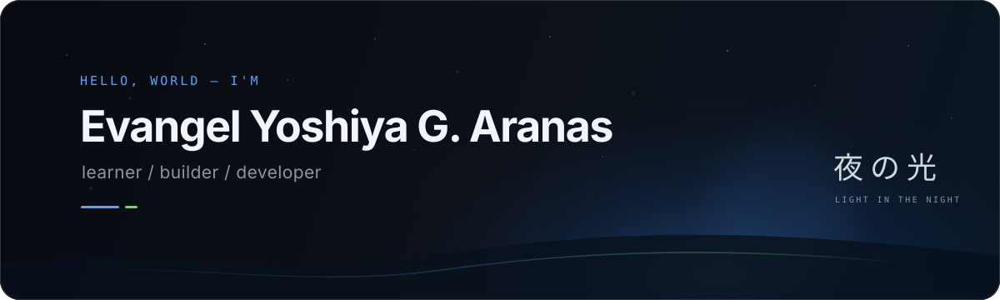

<p align="center">
  
</p>

<p align="center">
  <a href="https://github.com/Yoshi-dev-mode?tab=followers"></a>
  
  
</p>

## Hello, I'm Yoshi.

I'm a curious developer turning fundamentals into small, useful projects. Right now, I'm sharpening my Python skills, building with React and Next.js, exploring AI and cybersecurity, and documenting the lessons I learn along the way.

<details open>
  <summary><strong>What I'm exploring right now</strong></summary>
  <br />

  ```text
  learning   →  React, Next.js, and cybersecurity foundations
  building   →  small projects that make ideas tangible
  practicing →  Python, problem solving, and clean code
  exploring  →  how AI fits into useful, secure products
  ```

  <p>
    <a href="https://react.dev/">React docs</a> ·
    <a href="https://nextjs.org/docs">Next.js docs</a> ·
    <a href="https://owasp.org/www-project-top-ten/">OWASP Top 10</a>
  </p>
</details>

## Selected work

| Project | What it is | Built with |
| :--- | :--- | :--- |
| [LeetCode Solved Problems](https://github.com/Yoshi-dev-mode/Leetcode-Solved-Problems) | Documented solutions with explanations, patterns, and complexity notes. | `C++` `Python` |
| [Python Fundamentals](https://github.com/Yoshi-dev-mode/Python-Fundamentals) | Beginner-friendly exercises and examples for learning core Python concepts. | `Python` |

## Toolkit

<p>
  
</p>

## Contribution rhythm

<p align="center">
  <a href="https://github.com/Yoshi-dev-mode?tab=overview&from=2026-01-01&to=2026-12-31" title="Open my full contribution history">
    
  </a>
</p>

<p align="center"><sub>Live data · click the graph to explore the full timeline</sub></p>

## The next chapter

- Build and ship more complete projects
- Build polished full-stack experiences with React and Next.js
- Learn practical cybersecurity and secure development foundations
- Explore how AI features move from experiments into real products
- Keep improving in public, one commit at a time

<p align="center">
  <sub>夜の光 — find the light, then build toward it.</sub>
</p>
